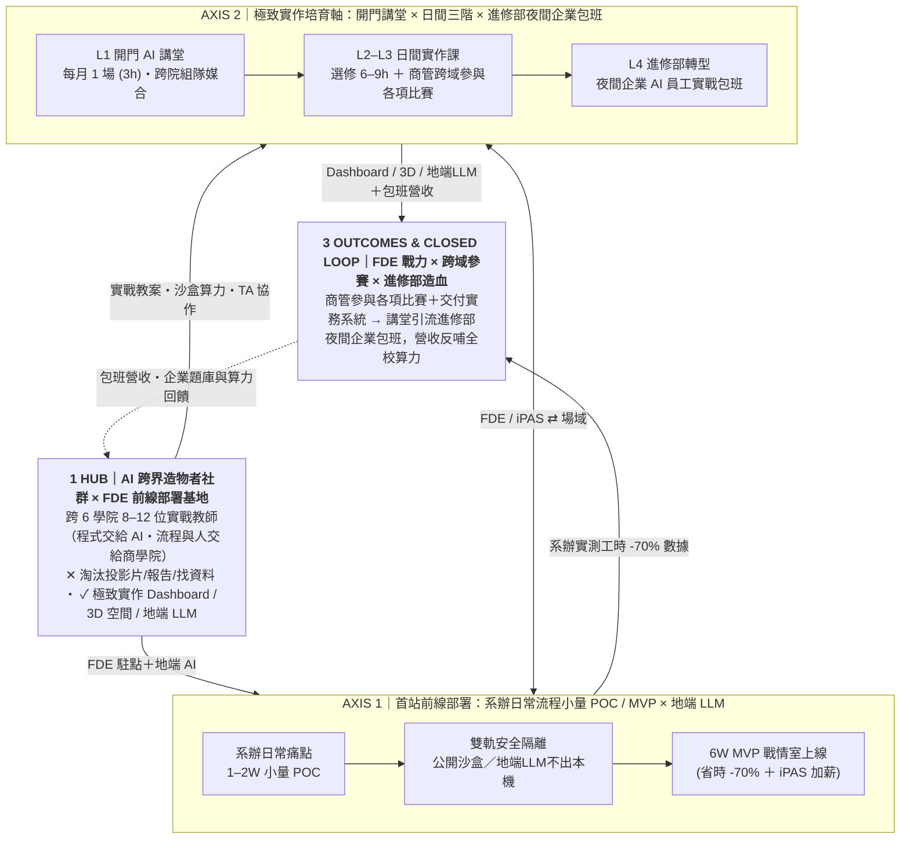
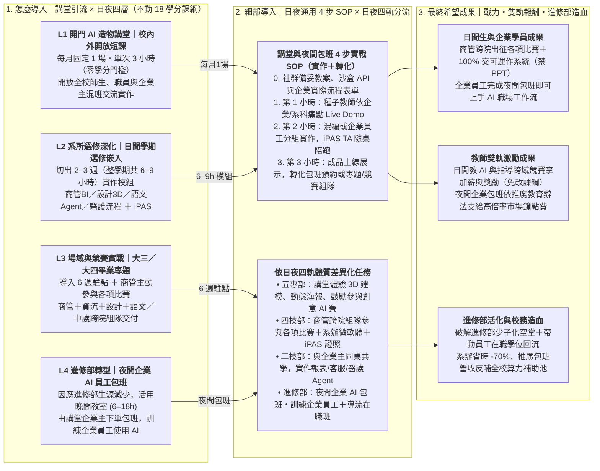
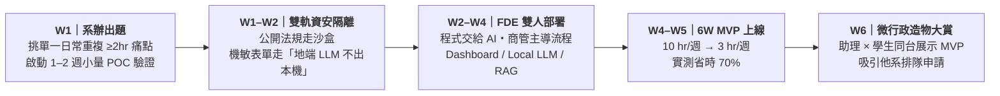
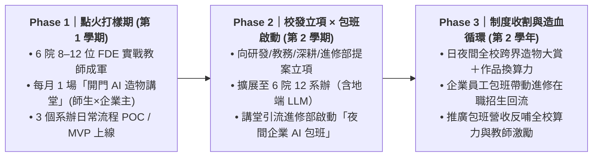

# 國立臺中科技大學「打開另一扇門：AI 跨界造物」校務發展計畫

[-nutcelvischen--jpg.github.io-7F0019?style=for-the-badge)](https://nutcelvischen-jpg.github.io/nutc-ai-open-door/)

> ### 👉 正式部署網址（點一下直接開網頁）：[https://nutcelvischen-jpg.github.io/nutc-ai-open-door/](https://nutcelvischen-jpg.github.io/nutc-ai-open-door/)
> - **備用即時預覽**：[https://raw.githack.com/nutcelvischen-jpg/nutc-ai-open-door/main/docs/index.html](https://raw.githack.com/nutcelvischen-jpg/nutc-ai-open-door/main/docs/index.html)
> - **計畫倉庫**：[`nutcelvischen-jpg/nutc-ai-open-door`](https://github.com/nutcelvischen-jpg/nutc-ai-open-door)
> - **完整計畫書**：[./PLAN.md](./PLAN.md) ｜ **分鏡設計規範**：[./Motion.md](./Motion.md) ｜ **26 格影片分鏡總覽**：[./docs/assets/sheet_zh.png](./docs/assets/sheet_zh.png)

淘汰「**做投影片、寫厚報告、單純上網找資料**」的舊時代作業！全面導入 **Forward Deployed Engineering（FDE，前線部署工程）**——**「程式碼交給 AI，業務流程與人交給商學院與領域專業」**；從校內「系辦」日常行政流程啟動 **小量 POC → MVP**，以極致實作課驅動 **15,600+ 師生** 直接產出數字決策 Dashboard、3D 立體空間視覺與 **不出本機的地端語言模型（Local LLM）**。

---

## 一、 計畫總體架構圖（1 核心 × FDE 系辦 POC × 日夜培育雙軸）

### FDE 前線部署工程 × 四大核心實務產出方向（徹底淘汰簡報與報告）

> **為什麼商學院最適合做 FDE？** 當程式碼生成可大量交給 AI，真正的勝負關鍵在「梳理企業 ERP 毛利、財稅法規、國貿單據與組織中的人」——這正是商學院與領域院系最擅長的主場；從全校最近的「系辦」日常流程做小量 **POC / MVP** 起步，全面以極致實作課產出可實際運行的系統：

| 實務產出方向 | 課程與場域實作內容 | 取代舊式作業之核心價值 |
| :--- | :--- | :--- |
| **📊 數字決策 Dashboard 與戰情室** | 系辦招生生源、修課統計與排課戰情室 MVP、企業營運與品牌動態儀表板 | 直接把日常表格與系辦數據變成可互動決策戰情室，取代靜態簡報與口頭報告 |
| **🌏 3D 立體空間數據視覺化** | 地理空間、地震時空開放數據、商圈區位與設計建模之三維 WebGL 互動網頁與語音導覽 | 讓非電資師生在程式交給 AI 後跨越門檻，將平面統計升級為立體空間敘事 |
| **🔒 地端語言模型（資料不出本機）** | 單機或單位電腦離線運行之 Local LLM 財報、合約條文檢核與證件欄位擷取助理 | 針對內部敏感表格、預算核銷與個資單據，確保 **資料 100% 不出本機、不進雲端** |
| **⚡ 系辦日常流程小量 POC → MVP** | 挑每週重複 ≥2 小時之法規問答、空白合約檢核、評鑑資料彙整與圖文排程等雜務 | 1–2 週快速驗證小量 **POC**，6 週收斂為 **MVP** 上線並達成減負 -70% 實績 |

---

## 二、 課程培育與進修部轉型架構圖（講堂引流 → 日夜雙軌導入 → 最終成果）

徹底釐清對象與造血漏斗：以 **「每月 1 場・單次 3 小時」《開門 AI 造物講堂》（全校師生 × 校外企業主混班短課）** 作為免費試乘破冰與跨院組隊媒合入口，日間銜接選修（6–9h）與 6 週專題（全面鼓勵商學院學生參與各項比賽與跨領域組隊實戰），夜間則針對進修部少子化現況轉型開辦 **「企業 AI 員工實戰包班」**：

> **以賽促學加速器（商學院學生參與各項比賽 × 跨領域組隊出征）**：
> * **突破技術門檻**：AI 寫碼讓商管學生不再卡關程式語法，能親手將商業洞察轉為可運行的 Dashboard、3D 互動系統或地端 AI 實品，主動報名商業創新、數據分析、資訊應用與黑客松等各項校外比賽。
> * **跨院混編戰隊**：透過講堂與選修媒合 **「商管 × 資流 × 設計 × 語文／中護」** 跨領域隊友共同備賽，以**可運作參賽系統直接取代傳統期末書面報告**，並優先獲得備賽算力與報名費補助，在真實外部評審實戰中大幅拉升解決問題與跨域整合能力。

---

## 三、 首站前線部署（FDE）：系辦日常流程小量 POC / MVP × 地端 LLM

---

## 四、 國內標竿校院策略定位對比（中部四校 ＋ 國立政治大學）

| 校別 | 他校模式 | 核心特徵 | 直接複製對中科大的風險／限制 | 臺中科大「跨界造物 × FDE」破局對應 |
| :--- | :--- | :--- | :--- | :--- |
| **東海大學** | 重算力基地 | 高資本硬體中心與長期採購 | 國立採購流程曠日廢時・設備驗收即過時 | 不打硬體軍備戰，採國內代理商統編授權＋地端 LLM 混合架構 |
| **暨南大學** | Astra 平台額度 | 統一平台帳號全面配發 | 無門檻大放送易淪為寫公文／聊天查詢 | 廢除無門檻大放送，改「以真實 Dashboard／MVP 作品換旗艦算力」 |
| **雲林科技大學** | AI4BI 18 學分 | 完整 18 學分跨院微學程 | 擠壓專業學分・非電資教師開課門檻過高 | 不擠壓滿載學分，改「開門講堂（3h）引流＋選修 6–9h＋FDE 專題」 |
| **逢甲大學** | 行政 AI 競賽 | 短期創意競賽導向 | 易流於靜態簡報展示，賽後無法日常維運 | **「系辦日常流程小量 POC → 6 週 MVP」**上線維運・實測省時 70% |
| **國立政治大學** | 電算 2–3h 工具研習 | 6 門 2–3h 短課（40人/班，含晚上班與教職員公文／廣宣專班）＋ A100／MI300X 行政優先節點 | 偏重雲端對話與寫公文報告，缺駐點人力落地系辦系統，敏資難上雲且純時數認證無造血 | 吸收「**零學分短課＋晚上班＋行政優先**」，升級為 **系辦 POC/MVP、地端 LLM 不出本機與夜間企業包班造血** |
| **國立臺中科技大學** | **FDE 核心 × 日夜雙軌** | **程式交給 AI、流程與人交給商學院 × 系辦 POC/地端 LLM × 夜間企業包班** | 資料不出本機・零核心系統更動・活化進修部空餘教室 | **徹底淘汰投影片與厚報告；日間交付實務系統、夜間企業包班營收反哺算力** |

> **政大（NCCU 115-1 電算中心 AI 應用課程）比較摘要**：
> * **借鏡吸收**：零學分 2–3 小時工作坊、兼顧師生的晚上班（18:00–20:00），以及算力核配「行政優先」排序。
> * **中科大升級破局**：不限於教寫公文與提案，而是直接派駐商管＋iPAS 特攻隊為系辦寫出可運行的微軟體與 Dashboard、將敏感表單留在 **地端 LLM（100% 不出本機）**，並將晚上班進一步升級為引流企業員工的 **進修部夜間包班造血引擎**。

---

## 五、 三階段滾動路線與合規防坑

* **實質推力三支柱（拒絕只靠熱忱義務推動）**：
  * **日間授課加薪 × 夜間包班高鐘點**：日間導入 AI 實作課程給鐘點加成（1.3–1.5×）與教材開發費；**進修部夜間企業 AI 包班**依《國立大學推廣教育實施辦法》支給高倍率市場鐘點費。
  * **持 AI iPAS 提高行政薪資與獎勵**：行政人員考取 AI iPAS 補助報名費＋發給獎金，納入約用／校務基金專業加給與考績調薪採計；系辦 POC/MVP 與推廣支援另發專案獎勵金與敘獎。
  * **AI 工具與算力費用補助（包班造血永續回補）**：開課或參與改造即配發基礎 AI 費用補助額度，交出實品再加碼旗艦算力；夜間企業包班推廣結餘持續回補全校算力補助池。
* **主計室合規核銷與推廣專帳**：避開個人境外刷卡，由國內代理商開立統編發票核銷雲端 API／教育授權；**進修部夜間企業包班** 依推廣教育規定專帳收支，合法支應夜間高鐘點、iPAS TA 工讀金與校務管理提撥。
* **資安雙軌紅線（去識別沙盒 × 地端 LLM 不出本機）**：公開業務走隔離沙盒（簽署保密切結，嚴禁姓名／學號／成績／身分證輸入雲端）；涉密表單與內部數據一律改採 **地端語言模型（Local LLM）於本機離線運行，資料 100% 不出本機**。
* **成果驗證標準（徹底淘汰 PPT 與書面報告）**：任何課程與受補助團隊**不再繳交投影片、厚報告或上網找資料作業**，必須附上可運行軟體、數據 Dashboard、3D 互動網頁或地端 AI 實機展示。

---

## 六、 目錄與檔案結構

* `docs/` — GitHub Pages 靜態藍圖網站（MUJI 米白亮色版：`index.html`、`styles.css`、`app.js`、`.nojekyll`、`assets/`）
* `videos/nutc_open_door/` — HTML + GSAP + Canvas 程式化動態影片專案
* `scripts/` — 音訊合成與 `earshot` 混音管線腳本
* [PLAN.md](./PLAN.md) — 完整校務發展計畫書
* [Motion.md](./Motion.md) — 7 幕影片視覺與動態分鏡規格
