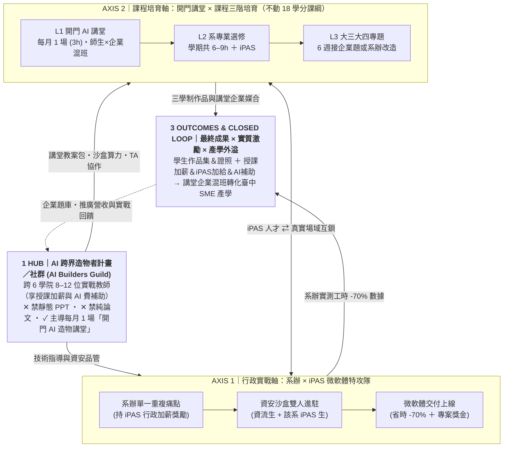
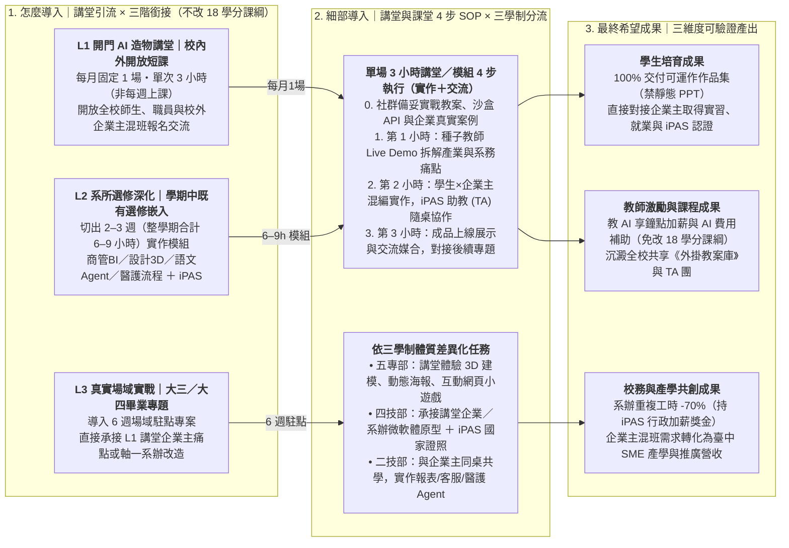
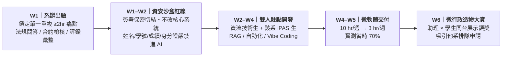
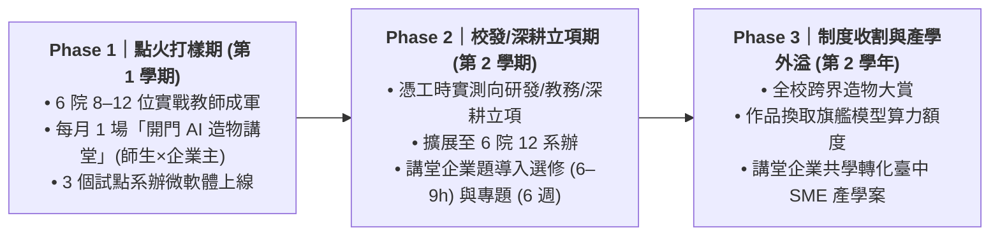

# 國立臺中科技大學「打開另一扇門：AI 跨界造物」校務發展計畫

> **線上藍圖網頁（MUJI 米白版 · 即時預覽）**：[https://raw.githack.com/nutcelvischen-jpg/nutc-ai-open-door/main/docs/index.html](https://raw.githack.com/nutcelvischen-jpg/nutc-ai-open-door/main/docs/index.html)
> **本機推播倉庫**：[`nutcelvischen-jpg/nutc-ai-open-door`](https://github.com/nutcelvischen-jpg/nutc-ai-open-door)（上游原版：[`DrChunChihChen/nutc-ai-open-door`](https://github.com/DrChunChihChen/nutc-ai-open-door)）
> **完整計畫書**：[./PLAN.md](./PLAN.md) ｜ **分鏡設計規範**：[./Motion.md](./Motion.md) ｜ **26 格影片分鏡總覽**：[./docs/assets/sheet_zh.png](./docs/assets/sheet_zh.png)

拒絕將 AI 矮化為「做簡報、寫公文」的文書加速器；以「**AI 跨界造物者計畫／社群**」為核心樞紐，驅動 **15,600+ 師生、6 大學院、五專／四技／二技** 同步推進「行政實戰」與「課程培育」雙軸生態。

---

## 一、 計畫總體架構圖（1 核心 × 雙軸驅動 × 成果閉環）

---

## 二、 學校課程培育導入架構圖（怎麼導入 → 細部導入 → 最終成果）

釐清各階段時數與校內外混班機制：以 **「每月 1 場・單次 3 小時」的《開門 AI 造物講堂》（全校師生 × 校外企業主混班短課）** 為入口，銜接學期中選修深化（共 6–9h）與 6 週場域專題：

---

## 三、 行政端 6 週資安沙盒改造流水線（軸一細部落地）

---

## 四、 中部各校策略定位對比

| 校別 | 他校模式 | 核心特徵 | 臺中科大「跨界造物雙軸引擎」破局對應 |
| :--- | :--- | :--- | :--- |
| **東海大學** | 重算力基地 | 高資本硬體中心與長期採購 | 不打硬體軍備戰，採國內代理商統編授權租賃雲端前沿池 |
| **暨南大學** | Astra 平台額度 | 統一平台帳號全面配發 | 廢除無門檻大放送，改「以真實作品換旗艦算力額度」 |
| **雲林科技大學** | AI4BI 18 學分 | 完整 18 學分跨院微學程 | 不擠壓滿載學分，改「每月 1 場開門 AI 講堂（3h）引流＋學期選修 6–9h＋6 週專題」 |
| **逢甲大學** | 行政 AI 競賽 | 短期創意競賽導向 | 「系辦 × iPAS」雙人 6 週駐點寫成可維運微軟體，實測省時 70% |
| **國立臺中科技大學** | **1 核心 × 雙軸驅動** | **造物者核心 × 行政微軟體 × 校內外混班 AI 講堂與三階導入** | **學生×企業主混班共學；授課加薪、持 iPAS 加給獎勵與 AI 費用補助** |

---

## 五、 三階段滾動路線與合規防坑

* **實質推力三支柱（拒絕只靠熱忱義務推動）**：
  * **教 AI 提高教師薪資**：導入 AI 跨界課程給予授課鐘點加成（如 1.3–1.5×）或專案教學加給＋教材開發費。
  * **持 AI iPAS 提高行政薪資與獎勵**：行政人員考取 AI iPAS 補助報名費＋發給獎金，納入約用／校務基金專業加給與考績調薪採計；系辦微改造上線另發專案獎勵金與敘獎。
  * **AI 工具與算力費用補助**：開課或參與改造即配發基礎 AI 費用補助額度（免自費訂閱），交出實品再加碼旗艦算力。
* **主計室合規核銷**：避開個人境外刷卡，透過國內代理商開立學校統編發票核銷雲端 API／教育團隊授權；並依法編列授課加給、教材開發費、行政持證專業加給與兼任工讀金。
* **資安與資料治理紅線**：簽署保密切結，所有 AI 工具僅處理公開法規、去識別化流程與空白表單檢核。
* **成果驗證標準**：任何受補助團隊必須附上可運行軟體連結、程式碼倉儲、3D 模型或動態影音成品。

---

## 六、 目錄與檔案結構

* `docs/` — GitHub Pages 靜態藍圖網站（MUJI 米白亮色版：`index.html`、`styles.css`、`app.js`、`.nojekyll`、`assets/`）
* `videos/nutc_open_door/` — HTML + GSAP + Canvas 程式化動態影片專案
* `scripts/` — 音訊合成與 `earshot` 混音管線腳本
* [PLAN.md](./PLAN.md) — 完整校務發展計畫書
* [Motion.md](./Motion.md) — 7 幕影片視覺與動態分鏡規格
